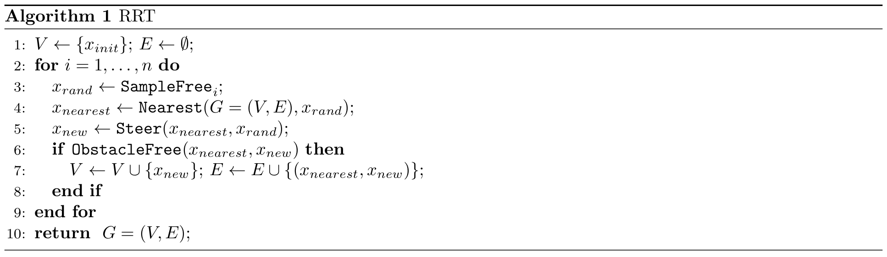
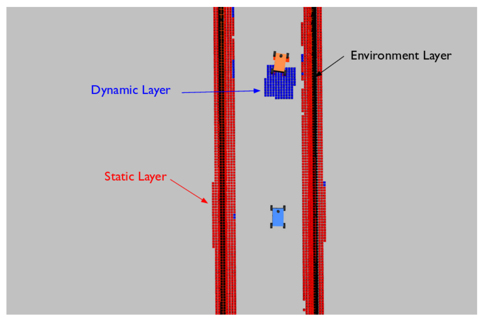
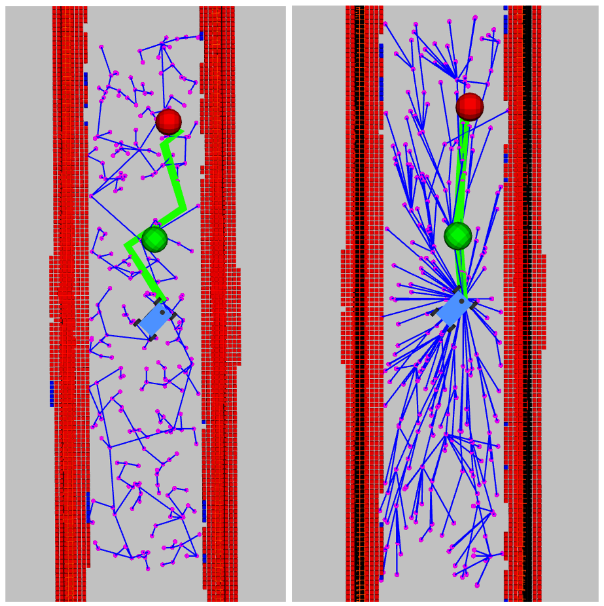

# Lab 8 - Motion Planning

> Adapted from the RoboRacer (F1TENTH) Lab 6: Motion Planning, MIT License. See `LICENSE`.

## I. Learning Goals

- Motion Planning basic concepts
  * Configuration space vs. Workspace: you should understand the difference between configuration space and workspace, and the advantages and disadvantages of planning in each of them.
  * Free space vs. Obstacle space: you should understand the difference between free space and obstacle space.
  * Occupancy grids and Costmaps: you should understand what occupancy grids and costmaps are, how to use them, and how to create them.
- Motion Planning algorithms
  * Sampling based algorithms: RRT and its variants.

## II. Overview

The goal of this lab is to provide you with tools that will help you in a head-to-head race on a race track. After finishing this lab, your car should be able to do something like [this](https://www.youtube.com/watch?v=llHCRqwIllM).

Before you start this lab, you should read the [paper](https://arxiv.org/pdf/1105.1186.pdf). Pay close attention to sections 3.1, 3.2, Algorithm 3, 3.3, Algorithm 6.

### RRT Pseudocode



The pseudocode of the basic version of RRT is listed as above. You can find all the details of the functions used by RRT in the paper. If you're implementing RRT*, or another version of RRT, read the RRT* section of the provided paper, and do some research to figure out how to modify the basic version of RRT.

### F1TENTH RRT vs. Generic RRT

In general, RRT is often used as a global planner where the tree is kept throughout the time steps. Whenever there is a new obstacle, and the occupancy grid changes, the tree will change accordingly. In our case, RRT is used as a local planner for obstacle avoidance. This is due to the fact that we don't have a well-defined starting point and goal point when we're racing on a track and we want to run continuous laps. In our implementation, we are only keeping a tree for the current time step in an area around the car. You could try to keep one tree that populates the map throughout the time steps, but speed is going to be an issue if you don't optimize how you're finding nodes, and traversing the tree.

For more details, you can check the slides from class for more details on the local planning scheme.

## III. Coding assignment

You can choose to implement RRT in either the workspace or configuration space. Since we're working with a car-like robot, the workspace will be the car's position in the world, and the configuration space will be whatever you decided to add on top of that (heading angle, velocity, etc.).

### Implementing an Occupancy Grid

You'll need to implement an occupancy grid for collision checking. Think about what is available to you (the map, the Laserscan messages, etc.), and construct a occupancy grid using those information. You can choose to either implement a binary occupancy grid (a grid cell is either 0 for unoccupied, or 1 for occupied), or use a probabilistic occupancy grid (a grid cell has values between 0 and 1 for probability that it is occupied). You could choose to implement either an occupancy grid in the car's local frame (our recommendation), or in the map's global frame. Depending on the size of the map that you use, think about how to compute updates to the occupancy grid and storing/using the occupancy grid efficiently. Since we're using RRT as a local planner, as in it comes up with a new path at every time step, you need to run everything relatively fast.  You'll also want to visualize the occupancy grid to ensure its correctness. You don't have to implement a multi-layer one like the one shown in the Figure.




Figure 2

### Working in the simulator and on the car

By this point, you should be pretty comfortable using the simulator to test your code. The ground truth pose of the car is available in the simulator, this would be useful for testing your algorithm in the simulator. When you test on the car, make sure you start slow, and increase your speed gradually. You'll see the effectiveness of your algorithm at a higher speed.

### Trajectory Execution

After you've found a path to your goal with RRT, there are different algorithms that you could use to follow that trajectory. The most obvious solution is the Pure Pursuit you wrote in Lab 6b. Picking the waypoint out of the path for pure pursuit will be the most important part if you decided to go down this route. You want a balance between having the car steering smoothly, and at the same time, reactive enough to avoid obstacles. Also, up-sampling the path for pure pursuit to pick out a waypoint is a good way to go.

### Hints

Think about how you could change the way that you're sampling the free space to speed up the process of finding a path to the goal. Also think about how the restrict the area in which you're sampling to make sure you don't have too big of a tree. Besides RRT*, there are other versions of RRT that takes into consideration of other variables (the dynamics of the car for example). After you're done with the basic version of RRT, you should do some research and implement a better version of RRT.

Make sure you visualize the tree you've expanded, and the path you've chosen as the trajectory.


## IV. Part C: RRT* (Extra credit)



Figure 3

You'll be rewarded extra credit (10%) for implementing RRT*, or another modified version of RRT (if you do, make a good argument on why it deserves extra credit). On top of the basic version of RRT, RRT* uses a cost function, and rewiring the tree, to find a better path to the goal. When the tree has expanded infinite number of nodes, RRT*'s solution is close to optimal. Figure 3 shows the difference in the tree expanded and path found between RRT and RRT*. The skeleton code provided has sections for functions in RRT* as well.

## V. How Your Planner Is Graded

The course staff grade your planner in the simulator on **`levine_obs`**, the simulator's Levine map with obstacles (the one from lab 4), counter-clockwise like every Levine run. Pick it on your laptop with `map_path: 'maps/levine_obs'` in `config/sim.yaml`, and set the start pose of the run you want to try:

| Graded run | `sx`, `sy`, `stheta` | What ends it |
| --- | --- | --- |
| Straight path | `8.08`, `8.67`, `3.1416` (the north hallway just out of the north-east corner, heading west) | 16 m along the hallway, under both triangles, 1.4 m before the L-shaped wall |
| Turn | `9.96`, `2.8`, `1.5708` (the east hallway, heading north: lab 4's start) | 3 m after the north-east corner, before the first triangle |
| Full lap | `9.96`, `2.8`, `1.5708` (the turn's start) | one whole lap past every obstacle: the triangles, the L-shaped wall (the way through is above its bar; below it is a dead end), the boxes of the south hallway, the ellipse and the box at the south-east corner |

The full lap is run first, and the turn and the straight path are stretches of it: when your lap gets past the end of one of them without touching anything, that run gets its full points and its time from the lap, and is not run again. Only a stretch your lap does not get past is run on its own, from the start pose in the table.

A run also ends at the first touch of a wall or an obstacle, or after 12 s without progress (the lap also after 180 s); a run that ends early earns partial credit for the fraction of its stretch, or of the lap, covered.

**One launch file.** The course staff start your code with `lab8_pkg/launch/levine_launch.py`, and nothing else, for every run:

```bash
ros2 launch lab8_pkg levine_launch.py
```

It is yours to edit: set `EXECUTABLE` to the node you wrote (`rrt_node.py` for Python, `rrt_node` for C++), put your tuned values in `PARAMETERS` (or give it a `.yaml` file), and start as many nodes as you like, in either language. Start your own nodes only: the simulator is already running. Without the launch file the staff fall back to `ros2 run lab8_pkg <executable>` with no parameter file, so tuned values must then be your node's defaults.

**Ship your waypoints with your package.** RRT plans locally towards a goal taken from a global path: put your CSV files in `lab8_pkg/waypoints/`; the skeleton's `CMakeLists.txt` installs that folder, and your node finds it with `get_package_share_directory('lab8_pkg')` (Python, `ament_index_python.packages`) or `ament_index_cpp::get_package_share_directory("lab8_pkg")` (C++). A path like `/home/you/sim_ws/...` only exists on your laptop: on the grading machine your node would die at start-up.


## VI. Deliverables and Submission

**This lab is done in teams.** Your team shares one repository.

1. Every member opens the **Create my lab repository** button on the Canvas assignment and chooses your team. The first member creates the team repository and the rest are added to it. Accept the invitation GitHub sends you.
2. Clone it into the `src` folder of your ROS 2 workspace (in the simulator, and on the car), then build and source the workspace.

All of you push to that one repository, so **pull before you push**. One submission is the whole team's submission, and every member gets the same grade.

- **Deliverable 1**: Commit your `lab8_pkg` package to your team's repository, waypoints included. Your committed code should run smoothly in simulation on `levine_obs`: a full counter-clockwise lap past every obstacle, without touching a wall or an obstacle (the straight path under both triangles and the north-east corner are also graded on their own).
- **Deliverable 2**: Submit links to two videos in **`SUBMISSION.md`** (YouTube unlisted, or Google Drive shared as **"Anyone with the link can view"**): your RRT running in the simulator with the tree and the chosen path visualized in RViz, and the real car running RRT in the CAE hallway.

### Submitting

1. Commit and push your work, waypoints included. Check on github.com that your latest commit is there.
2. Submit the URL of your team's repository on the Canvas assignment.

**The course staff find your work by name.** Package `lab8_pkg`, launch file `levine_launch.py` (or, without it, an executable it can start with `ros2 run lab8_pkg <executable>`, the skeleton's `rrt_node`), taking its pose from `/ego_racecar/odom`, reading `/scan` and publishing `AckermannDriveStamped` on `/drive`. Otherwise, your work cannot be run for grading and your submission may get the wrong grade.

**Only the topics the lab needs.** Your nodes may read the simulator's localisation (`/ego_racecar/odom`, `/tf`), `/scan` and `/initialpose`, and publish on `/drive`, `/tf` and topics only your own nodes use (path and waypoint markers). The course staff check the ROS graph while your code runs: a node that reads the lap counter or the collision flag, or publishes on a topic the simulator listens to (`/initialpose`, which teleports the car, `/ego_racecar/odom`, the lap counter, ...) scores 0 on every run.

## VII. Grading Rubric
- Compilation: **30** Points (the package builds)
- Performance on straight path: **20** Points (graded in simulation: the north hallway of `levine_obs` under both triangles, without touching anything; full points when your full lap gets past it cleanly, otherwise a run of its own where ending early earns partial credit for the fraction covered)
- Performance on turn: **20** Points (graded in simulation, the same way: the north-east corner of `levine_obs`)
- Full lap of the obstacle map: **10** Points (graded in simulation, the same way: one counter-clockwise lap of `levine_obs` past every obstacle)
- Videos (graded from the links in `SUBMISSION.md`):
  - **10** Points working in Simulation
  - **10** Points working on Car - you need to demonstrate the car avoiding at least one obstacle
- RRT* or another improved RRT: extra credit **10** Points (graded from the code and the video)

**Total: 100 Points**
